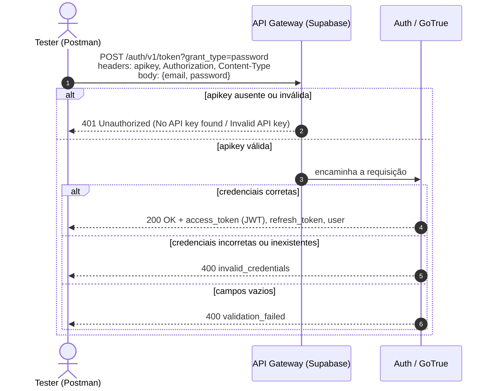

<div align="center">
FoodExpress — Testes Funcionais Caixa Cinza da API de Autenticação (Supabase + Postman)
UniFacens · Cursos Tecnológicos · AS406TSN1 · UX/UI e Testes de Software · Aula 11
</div>
> ⚠️ **Aviso de transparência.** Conforme o enunciado da atividade, a execução dos testes e as evidências (prints, logs, respostas JSON) foram **simulados** pela IA com dados coerentes com o comportamento documentado do Supabase Auth (GoTrue). As URLs, chaves, UUIDs e tokens são **fictícios** (as assinaturas JWT contêm o texto `SIMULADO`). Toda imagem em `/prints/` traz a faixa *"EVIDÊNCIA SIMULADA"*. A única análise feita sobre código **real** é a revisão do front-end do projeto FoodExpress (`Login.jsx` e `Signup.jsx`), que gerou o defeito **CT08**.
---
Introdução
O FoodExpress é um e-commerce de comida cujo protótipo de baixa fidelidade (React + Vite) possui as telas de cadastro e login, mas não possui conexão com banco de dados. Os requisitos funcionais cobertos aqui são:
ID	Requisito	Operação	Resultado esperado
1	Registrar-se	Cliente cria uma conta	Conta criada com sucesso
2	Fazer Login	Cliente acessa o sistema	Login realizado com sucesso
Para validar a autenticação antes de integrá-la ao front-end, utilizou-se o Supabase Auth como back-end e o Postman Desktop como cliente de testes. Como a atividade é de caixa cinza, o testador conhece parte da estrutura interna (endpoint, headers, formato do body, códigos HTTP e o papel do API Gateway), mas não o código-fonte do servidor de autenticação.
Estrutura do repositório
```text
/README.md                      → documentação técnica completa (este arquivo)
/postman/                       → coleção e environment importáveis no Postman
    FoodExpress_API_Tests.postman_collection.json
    FoodExpress_Supabase.postman_environment.json
/prints/                        → evidências (telas simuladas do Supabase e do Postman)
/planilha/                      → planilha de testes (.xlsx com 4 abas) e Registro_dos_Testes.csv
```
Fluxo de autenticação testado

---
Objetivo da Atividade
Compreender e aplicar testes funcionais de caixa cinza em uma API de autenticação, utilizando ferramentas de mercado. Especificamente:
Configurar um ambiente de autenticação no Supabase;
Criar um usuário válido para testes;
Compreender o funcionamento de requisições HTTP (método, endpoint, headers, body, status);
Configurar e executar testes no Postman (Workspace, Environment, Collection, scripts de teste);
Validar status HTTP, corpo JSON, mensagens de erro e access token;
Documentar tecnicamente todo o processo neste README, com planilha de registro.
Não há implementação de interface gráfica nesta atividade.
---
Configuração do Supabase
Como o projeto foi criado
Acesso a https://supabase.com → Start your project → cadastro com conta GitHub (plano Free, limite de 2 projetos).
New project com os dados abaixo (opções Security Options e Advanced Configuration mantidas no padrão: Data API + Connection String, public schema, Postgres):
Campo	Valor
Organization	org-aluno-facens (Free)
Project name	`foodexpress-auth-tests`
Database password	gerada pelo botão Generate a password (guardada fora do repositório)
Region	South America (São Paulo) — `sa-east-1`
Aguardado o provisionamento; o painel exibiu o status Healthy e o Project ref `xkqzmvtbnhdwlyrcjepa` (fictício).

Tipo de autenticação
Em Authentication → Sign In / Providers:
Provedor Email: Enabled (autenticação por e-mail e senha);
Allow new users to sign up: ligado;
Confirm email: desmarcado, pois a confirmação é opcional e o e-mail de teste não possui caixa de entrada real. Com isso o usuário criado pode autenticar imediatamente;
Provedores de terceiros, login anônimo e manual linking: desligados.

Criação do usuário de teste
Authentication → Users → Add user → Create new user, com Auto Confirm User marcado:
Campo	Valor
E-mail	`teste.cinza@foodexpress.test`
Senha	`Teste@12345` (apenas para ambiente de teste)
UID	`3f8a6c1e-7b24-4d9a-a1c5-92e0d6b7f401`
Provider	Email

Credenciais da API
Obtidas em Project Settings → API:
Item	Valor (fictício)
API URL	`https://xkqzmvtbnhdwlyrcjepa.supabase.co`
API KEY (`anon` / `public`)	`eyJhbGciOiJIUzI1NiIsInR5cCI6IkpXVCJ9.eyJpc3MiOiJzdXBhYmFzZSIs…SIMULADO_NAO_E_UMA_CHAVE_REAL`
A chave `service_role` não é usada: ela ignora o Row Level Security e jamais deve ser exposta no cliente.

Identificação do agente no ambiente
Item	Valor
Agente executor	IA (Claude), em nome do aluno
Data da execução	06/11/2026
Conta / organização	org-aluno-facens (plano Free)
Projeto	`foodexpress-auth-tests`
Objetivo da configuração
Dispor de um provedor de identidade real (Postgres + GoTrue) para validar, antes de integrar o front-end, que a API autentica credenciais válidas, rejeita inválidas e protege o acesso via `apikey`.
---
Configuração do Postman
Workspace
Postman Desktop instalado a partir de https://www.postman.com/downloads/ e conectado à conta do aluno. Em Workspaces → Create Workspace foi criado o workspace `FoodExpress Supabase` (Personal), onde ficam o Environment e a Collection `FoodExpress API Tests`.
Environment e variáveis
Em Environments foi criado o ambiente `FoodExpress Supabase` e selecionado como ativo (canto superior direito). As variáveis evitam repetir dados sensíveis em cada requisição e permitem trocar de projeto Supabase alterando um único lugar.
Variável	Descrição	Valor
`base_url`	URL da API do Supabase	`https://xkqzmvtbnhdwlyrcjepa.supabase.co`
`api_key`	API KEY (anon public)	(tipo secret)
`email`	Usuário criado	`teste.cinza@foodexpress.test`
`password`	Senha criada	(tipo secret)
`email_inexistente`	Extra: e-mail não cadastrado (CT03)	`nao.existe@foodexpress.test`
`password_errada`	Extra: senha incorreta (CT02)	(tipo secret)
`access_token`	Extra: preenchida pelo script do CT01	(vazia até o login)
Como o Postman é usado nos testes
Cada cenário é uma requisição da coleção, com scripts de teste (aba Scripts → Post-response) que validam automaticamente status, JSON e mensagens. A coleção é executada pelo Runner (Run FoodExpress API Tests) e gera o relatório de aprovados/reprovados. Para reproduzir, importe os dois arquivos da pasta `/postman` e preencha `api_key` e `password` com os valores do seu projeto.

---
Configuração das Requisições
Resumo
Item	Valor
Endpoint	`/auth/v1/token?grant_type=password`
URL completa	`{{base_url}}/auth/v1/token?grant_type=password`
Método HTTP	`POST`
Finalidade	Autenticar o usuário por e-mail e senha e obter o access token (JWT) da sessão
Headers
Key	Value	Função
`apikey`	`{{api_key}}`	Identifica o projeto no API Gateway (obrigatório)
`Authorization`	`Bearer {{api_key}}`	Autorização do gateway (com a chave anon)
`Content-Type`	`application/json`	Indica que o corpo é JSON
```http
POST {{base_url}}/auth/v1/token?grant_type=password HTTP/1.1
apikey: {{api_key}}
Authorization: Bearer {{api_key}}
Content-Type: application/json
```
Body (raw · JSON)
```json
{
  "email": "{{email}}",
  "password": "{{password}}"
}
```
Com as variáveis resolvidas (CT01):
```json
{
  "email": "teste.cinza@foodexpress.test",
  "password": "Teste@12345"
}
```
Script de teste do CT01 (aba Scripts)
```javascript
pm.test("CT01 - Status code é 200", function () { pm.response.to.have.status(200); });
pm.test("CT01 - Resposta contém access_token", function () {
  var j = pm.response.json();
  pm.expect(j).to.have.property("access_token");
  pm.expect(j.token_type).to.eql("bearer");
  pm.expect(j.user.email).to.eql(pm.environment.get("email"));
  pm.environment.set("access_token", j.access_token);
});
pm.test("CT01 - Tempo de resposta < 2000 ms", function () { pm.expect(pm.response.responseTime).to.be.below(2000); });
```
Os demais cenários foram criados duplicando a requisição do CT01 e alterando título, body e scripts (veja a coleção em `/postman`).

---
Execução dos Testes
Execução simulada em 06/11/2026, 14:58, ambiente FoodExpress Supabase, 1 iteração, 7 requisições / 23 asserções.
Tabela de Cenários
Cenário	Entrada	Resultado esperado	Resultado obtido	Status
CT01 Login válido	`teste.cinza@foodexpress.test` / `Teste@12345`	Status 200 + access token	200 OK, `access_token` JWT, `token_type: bearer`, `expires_in: 3600`	✅ Aprovado
CT02 Senha incorreta	e-mail válido / `SenhaErrada#999`	Erro de autenticação	400, `invalid_credentials`	✅ Aprovado
CT03 Usuário inexistente	`nao.existe@foodexpress.test` / `Teste@12345`	Acesso negado	400, `invalid_credentials`	✅ Aprovado
CT04 Campos vazios	`""` / `""`	Erro de validação	400, `validation_failed`	✅ Aprovado
CT05 Credenciais inválidas	`isto-nao-e-um-email` / `123`	Mensagem de erro	400, `"Invalid login credentials"`	✅ Aprovado
CT06 (complementar) Sem `apikey`	sem headers de chave	401 do gateway	401, `No API key found in request`	✅ Aprovado
CT07 (complementar) `apikey` inválida	`chave-invalida-123`	401 do gateway	401, `Invalid API key`	✅ Aprovado
CT08 (revisão de código) Front-end aceita credenciais falsas	`qualquer@x.com` / `x` em `Login.jsx`	Acesso bloqueado	Redireciona para `/catalog` sem consultar o Supabase	❌ Reprovado
Evidências — testes válidos
CT01 — Login válido (`200 OK`, 412 ms):
```json
{
  "access_token": "eyJhbGciOiJIUzI1NiIsInR5cCI6IkpXVCJ9.eyJpc3MiOi…SIMULADO_ASSINATURA",
  "token_type": "bearer",
  "expires_in": 3600,
  "expires_at": 1793003600,
  "refresh_token": "k3p9x2vq7mzl",
  "user": {
    "id": "3f8a6c1e-7b24-4d9a-a1c5-92e0d6b7f401",
    "aud": "authenticated",
    "role": "authenticated",
    "email": "teste.cinza@foodexpress.test",
    "email_confirmed_at": "2026-11-06T17:52:10Z"
  }
}
```
Validações: status 200 ✔ · `access_token` presente ✔ · `token_type = bearer` ✔ · e-mail do `user` confere ✔ · tempo < 2000 ms ✔ · token gravado em `{{access_token}}` ✔.

Evidências — testes inválidos
CT02 — Senha incorreta (`400 Bad Request`, 287 ms) e CT03 — Usuário inexistente (`400`, 301 ms) retornam o mesmo corpo:
```json
{
  "code": 400,
  "error_code": "invalid_credentials",
  "msg": "Invalid login credentials"
}
```
CT04 — Campos vazios (`400`, 118 ms):
```json
{
  "code": 400,
  "error_code": "validation_failed",
  "msg": "Email and password are required"
}
```
CT05 — Credenciais inválidas (`400`, 142 ms): mesmo corpo do CT02.
CT06 — Sem `apikey` (`401`, 96 ms) e CT07 — `apikey` inválida (`401`, 104 ms) são respondidos pelo API Gateway:
```json
{ "message": "No API key found in request", "hint": "No `apikey` request header or url param was found." }
```
```json
{ "message": "Invalid API key", "hint": "Double check your Supabase `anon` or `service_role` API key." }
```


Resumo do Runner

Erros encontrados
CT08 (defeito real, do código do projeto). Em `src/pages/Login.jsx`, `handleLogin` executa apenas `if (email && password) navigate("/catalog")`: qualquer par preenchido libera o acesso, sem chamar o Supabase. Em `src/pages/Signup.jsx`, `handleSignup` faz `console.log("Novo usuário:", { email, password })` (a senha é escrita no console) e navega para `/catalog` sem criar a conta. Ou seja, a API autentica corretamente, mas o requisito Fazer Login/Registrar-se ainda não é atendido na interface.
Observação CT03. O Supabase devolve a mesma resposta para "usuário inexistente" e "senha incorreta". Isso não é defeito: é uma proteção contra enumeração de usuários. O resultado esperado "acesso negado" foi atendido.
---
Registro dos Testes
Os testes foram registrados na planilha `planilha/Planilha_Testes_CaixaCinza_FoodExpress.xlsx` (cópia em CSV: `Registro_dos_Testes.csv`), seguindo o modelo apresentado na aula, com 4 abas:
Aba	Conteúdo
Informação	Projeto, ambiente, responsável, data, endpoint, usuário de teste
Sistema	Testes por componente (Interface de Login, Servidor de Autenticação)
Aceitação	Testes por requisito (Registrar-se, Fazer Login)
Registro dos Testes	ID, Cenário, Entrada, Resultado esperado, Resultado obtido, Status, Observações
Importância do registro. A documentação torna os testes repetíveis e auditáveis, dá rastreabilidade entre requisito → cenário → resultado, evidencia regressões em execuções futuras e serve de base para o time decidir se a funcionalidade pode ser integrada.
Registros realizados (aba Registro dos Testes):
ID do teste	Cenário	Entrada	Resultado esperado	Resultado obtido	Status	Observações
CT01	Login válido	`teste.cinza@foodexpress.test` / `Teste@12345`	200 + access_token	200 OK (412 ms); JWT, `bearer`, `expires_in` 3600	Aprovado	Token salvo no Environment
CT02	Senha incorreta	e-mail válido / `SenhaErrada#999`	Erro de autenticação	400 `invalid_credentials` (287 ms)	Aprovado	Sem `access_token`
CT03	Usuário inexistente	`nao.existe@foodexpress.test`	Acesso negado	400 `invalid_credentials` (301 ms)	Aprovado	Igual ao CT02: evita enumeração
CT04	Campos vazios	`""` / `""`	Erro de validação	400 `validation_failed` (118 ms)	Aprovado	Texto exato a confirmar em execução real
CT05	Credenciais inválidas (formato)	`isto-nao-e-um-email` / `123`	Mensagem de erro	400 `invalid_credentials` (142 ms)	Aprovado	Servidor não detalha o motivo
CT06	Sem `apikey`	sem headers de chave	401 do gateway	401 `No API key found` (96 ms)	Aprovado	Bloqueio no gateway
CT07	`apikey` inválida	`chave-invalida-123`	401 do gateway	401 `Invalid API key` (104 ms)	Aprovado	
CT08	Integração do front-end	`qualquer@x.com` / `x`	Acesso bloqueado	Redireciona a `/catalog`	Reprovado	`Login.jsx` não chama o Supabase
Falhas identificadas: CT08 (front-end sem integração) e o log de senha em `Signup.jsx`. Nenhuma falha na API de autenticação.
---
Resultados Obtidos
Indicador	Resultado
Cenários obrigatórios (CT01–CT05)	5/5 aprovados
Cenários complementares (CT06–CT07)	2/2 aprovados
Verificação do front-end (CT08)	0/1 — reprovado
Total	7 aprovados · 1 reprovado (8 testes)
Asserções do Postman	23/23 aprovadas
Tempo médio de resposta (API)	209 ms (mín. 96 ms · máx. 412 ms)
Rastreabilidade com os requisitos (aba Aceitação):
Requisito	Situação
1 — Registrar-se	Parcial: o usuário existe no Supabase (criado pelo painel); o cadastro pela tela não chama a API
2 — Fazer Login	Parcial: a API autentica corretamente; a tela de login não chama a API
---
Conclusão
Os testes foram executados corretamente? Sim, dentro do escopo proposto: os cinco cenários obrigatórios mais dois complementares foram cobertos com entradas, resultados esperados e obtidos registrados. Ressalva importante: a execução e as evidências são simuladas, conforme o enunciado; os resultados refletem o comportamento documentado do Supabase Auth, mas mensagens exatas (por exemplo, a do CT04) podem variar conforme a versão do GoTrue e devem ser confirmadas em uma execução real.
A autenticação funcionou? Sim. A API entrega `200` e um JWT para credenciais válidas, nega com `400 invalid_credentials` as incorretas ou inexistentes, devolve erro de validação para campos vazios e o gateway bloqueia com `401` requisições sem `apikey` válida.
Dificuldades mapeadas
Entender a diferença entre `apikey`/`Authorization` (gateway) e o `access_token` (sessão do usuário);
Decidir sobre Confirm email: ligado exige e-mail real; desligado simplifica o ambiente de testes;
O Supabase não diferencia "senha errada" de "usuário inexistente", o que exige interpretar o resultado esperado do cenário CT03;
Manter chaves fora do repositório (variáveis secret e valores fictícios no versionamento).
Falhas identificadas
CT08: o front-end (`Login.jsx`) libera o acesso a qualquer e-mail/senha preenchidos; `Signup.jsx` não cria a conta e escreve a senha no console.
Melhorias sugeridas
Integrar o front-end com `@supabase/supabase-js` (`signInWithPassword` e `signUp`), tratando erros e exibindo mensagem ao usuário (fluxo alternativo do caso de uso Login inválido);
Proteger as rotas (`/catalog`, `/cart`, `/checkout`…) exigindo sessão válida;
Remover o `console.log` com a senha;
Habilitar Confirm email e políticas de senha mais fortes em produção;
Adicionar testes de borda: e-mail com espaços/maiúsculas, senha muito longa, injeção (`' OR 1=1 --`), bloqueio por excesso de tentativas (rate limit), expiração e renovação do token (`grant_type=refresh_token`);
Automatizar a coleção no CI com Newman: `newman run postman/FoodExpress_API_Tests.postman_collection.json -e postman/FoodExpress_Supabase.postman_environment.json`;
Usar o `access_token` do CT01 em chamadas autenticadas (ex.: `GET /auth/v1/user`).
Importância dos testes caixa cinza em APIs. Combinam a visão de comportamento (caixa preta) com conhecimento parcial de endpoints, headers, contratos e códigos de erro. Isso permite testar a camada de serviço diretamente, sem depender da interface, detectar cedo problemas de contrato, segurança e validação, e isolar onde o defeito está: aqui, a API estava correta e o defeito estava na integração do front-end (CT08), o que só ficou evidente por separar os dois níveis de teste.
